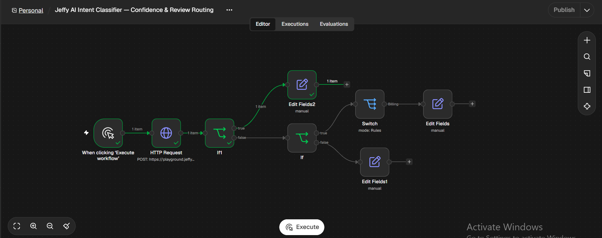
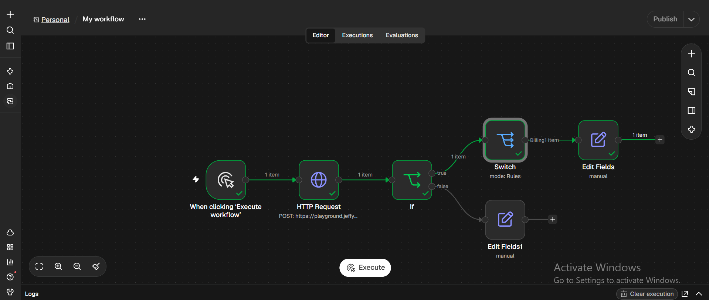
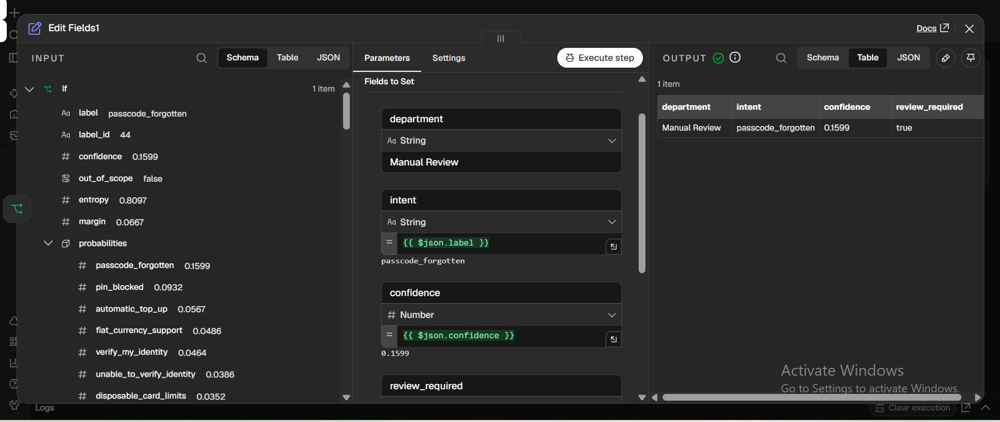
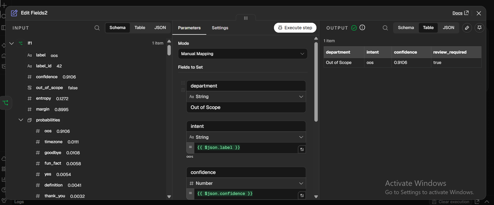

# Jeffy AI Intent Classifier — Confidence & Review Routing

A practical n8n Cloud workflow that integrates Jeffy's text-classification API and routes predictions to business-oriented outcomes using intent labels and a confidence threshold.

> **Implementation note:** This project calls Jeffy's API through n8n's built-in **HTTP Request** node. It does not install or use the `n8n-nodes-jeffy` community node. The community-node installation option was not available in the n8n Cloud workspace used for this demo.

## What it demonstrates

- Calling the Jeffy classification endpoint from n8n.
- Routing a known banking intent to a Billing department.
- Sending low-confidence predictions to Manual Review.
- Routing the predicted `oos` label to an Out of Scope department and marking it for review.
- Mapping classifier output into a compact downstream object containing department, intent, confidence, and review status.

## Workflow

```text
Manual Execute Trigger
        |
        v
HTTP Request — Jeffy /v1/predict
        |
        v
Check predicted label == "oos"
        | true                         | false
        v                              v
Out of Scope                     Check confidence >= 0.8
department                            | true       | false
review required                       v            v
                                  Intent Switch   Manual Review
                                  (Billing route) review required
```

The actual workflow is saved in n8n as **Jeffy AI Intent Classifier — Confidence & Review Routing**.

**Download or inspect the workflow JSON:**

[Download the n8n workflow JSON](./Jeffy%20AI%20Intent%20Classifier%20%E2%80%94%20Confidence%20%26%20Review%20Routing.json)

To reproduce this demo, import the JSON workflow into your n8n workspace and configure the HTTP Request node and any required settings for your environment.

## API request

The workflow sends a JSON request to:

```http
POST https://playground.jeffyclassify.com/v1/predict
Content-Type: application/json
```

Example request used for the banking-intent test:

```json
{
  "text": "I was charged twice for the same transaction",
  "task": "banking77"
}
```

## Verified test cases

| Scenario | Observed classifier output | Workflow result |
|---|---|---|
| Billing | `transaction_charged_twice`, confidence `0.999` | Routed to **Billing** |
| Low confidence | `passcode_forgotten`, confidence `0.1599` | Routed to **Manual Review**, `review_required: true` |
| Out-of-scope label | `oos`, confidence `0.9106` | Routed to **Out of Scope**, `review_required: true` |

These are example test observations from the demo, not a general accuracy benchmark. The low-confidence test intentionally used the input `asdf qwer blorp`; its predicted label should not be interpreted as a validated classification of that text.

## Important routing detail

The Out of Scope branch checks whether the predicted `label` equals `oos`. In the observed response for that test, the API's separate `out_of_scope` Boolean was `false`. Therefore, this demo demonstrates **label-based OOS routing**, not routing based on the Boolean flag. This distinction should be reviewed against the API's documented semantics before using the pattern in another workflow.

The confidence branch uses a threshold of **0.8**. Predictions below that threshold are sent to Manual Review instead of being treated as confidently classified.

## How to reproduce

1. Open an n8n Cloud workspace.
2. Import the [workflow JSON](./Jeffy%20AI%20Intent%20Classifier%20%E2%80%94%20Confidence%20%26%20Review%20Routing.json), or add a **Manual Trigger** and an **HTTP Request** node.
3. Configure the request as `POST` to `https://playground.jeffyclassify.com/v1/predict`, with JSON body fields `text` and `task`.
4. Add an IF node to check `{{$json.label}}` equals `oos`.
5. Route the true branch to an Edit Fields node that sets `department = Out of Scope`, `intent = oos`, and `review_required = true`.
6. On the other branch, check whether `{{$json.confidence}}` is greater than or equal to `0.8`.
7. Send the false branch to Manual Review. Send the true branch to a Switch node that routes known intent labels, including `transaction_charged_twice`, to Billing.
8. Execute each test input and inspect the node outputs.

Node labels and field names may be adjusted to match the workflow version you build.

## Limitations

- The workflow is a portfolio/demo integration and has been manually tested with the scenarios listed above.
- It does not demonstrate a comprehensive evaluation dataset, multilingual performance, or production-level accuracy.
- It does not install the Jeffy community node; it calls the API using n8n's built-in HTTP Request node.
- The workflow currently starts manually. A production deployment would need an appropriate trigger, input validation, error handling, observability, and review/ownership rules.
- Keep external API behavior, terms, availability, and rate limits in mind before relying on the endpoint for business-critical processing.

## Screenshots

### Workflow Overview


### Billing Test


### Manual Review Test


### Out of Scope Test

